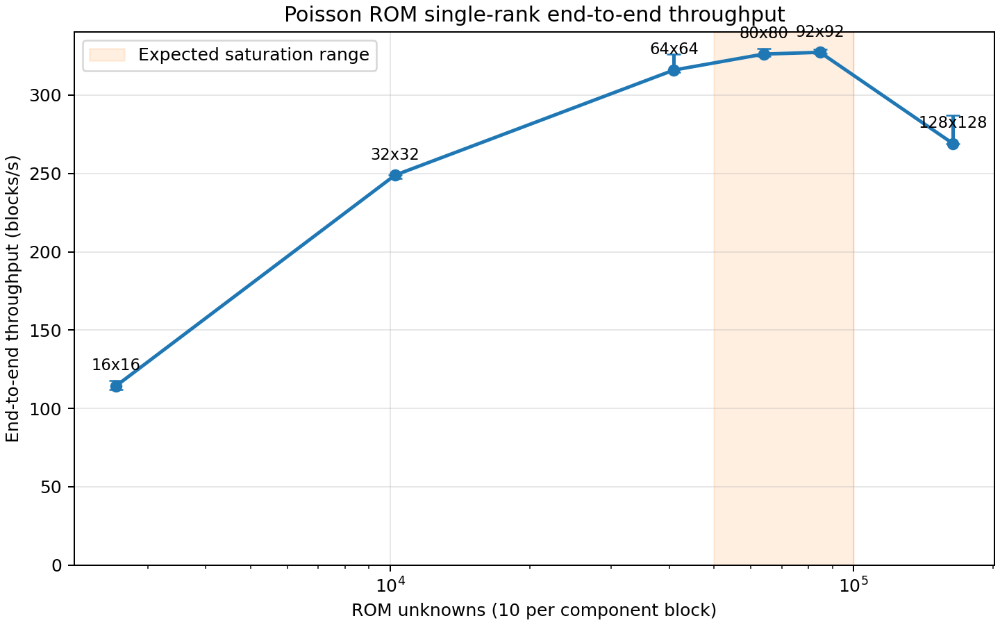
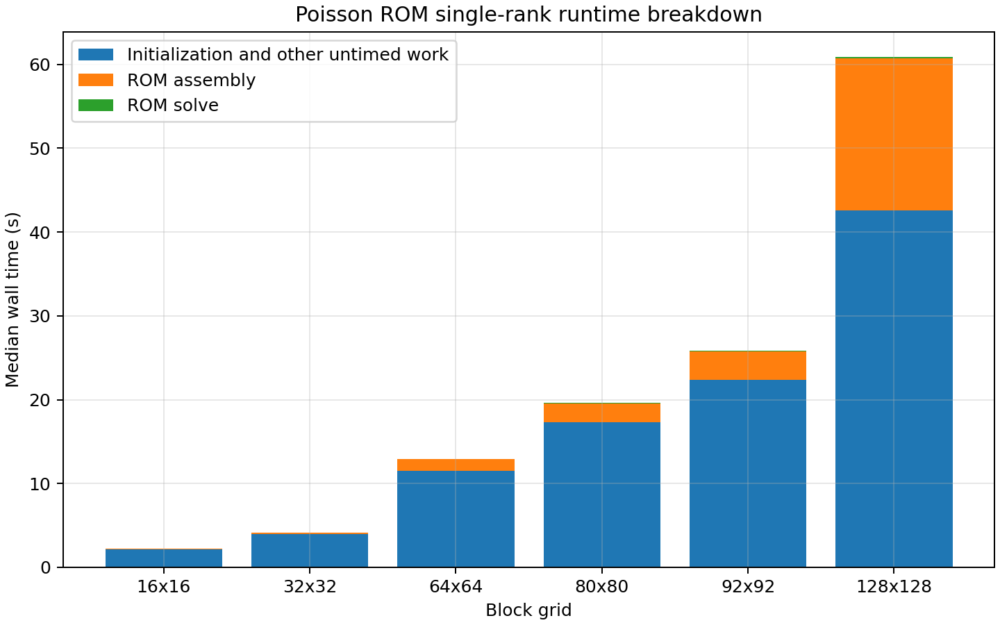

# Poisson ROM Scaling Results

## Strong-scaling experiment

The component Poisson ROM was run on a fixed 128-by-128 configuration:

- 16,384 component blocks;
- 10 reduced basis coefficients per block;
- 163,840 total ROM unknowns;
- 1, 2, 4, 8, and 16 MPI ranks; and
- three repetitions per rank count.

The table reports medians. End-to-end time is the complete `srun` duration.
Kernel time is the application's reported ROM assembly plus solve time.

| MPI ranks | Wall time (s) | Wall speedup | Wall efficiency | Kernel time (s) | Kernel speedup | Wall throughput (blocks/s) |
|---:|---:|---:|---:|---:|---:|---:|
| 1  | 58.06 | 1.00 | 100% | 16.17 | 1.00 | 282 |
| 2  | 33.90 | 1.71 | 86%  | 11.38 | 1.42 | 483 |
| 4  | 23.64 | 2.46 | 61%  | 10.25 | 1.58 | 693 |
| 8  | 17.43 | 3.33 | 42%  | 9.40  | 1.72 | 940 |
| 16 | 14.78 | 3.93 | 25%  | 8.92  | 1.81 | 1,109 |


## Conclusions

- The implementation provides useful end-to-end scaling through 16 ranks, but
  it is substantially sublinear. Sixteen ranks give a 3.93-times wall-clock
  speedup and approximately 25% parallel efficiency.
- Initialization and other work outside the reported ROM kernel remain the
  largest contribution. At the median, this work falls from about 41.9 seconds
  on one rank to 5.9 seconds on 16 ranks.
- ROM kernel scaling plateaus early. Its median time decreases from 16.17 to
  8.92 seconds, only a 1.81-times speedup on 16 ranks.
- The reduced linear solve scales from approximately 0.123 seconds to 0.020
  seconds and is negligible in the overall runtime. ROM assembly, rather than
  the solve, dominates the timed kernel.
- The assembly path retains globally structured work. In particular, current
  code comments identify global block construction and scans over all ROM
  blocks as work that should be made local. This is a likely contributor to the
  observed kernel plateau.
- Increasing from 8 to 16 ranks reduces median wall time by only about 15%.
  For this problem and implementation, 8 ranks offer a better efficiency/time
  compromise, while 16 ranks provide the best observed time to solution.

## Reproducing the plots

From `build/examples/poisson_parallel`, run:

```bash
MPLCONFIGDIR=/tmp/matplotlib-cache ./plot_benchmarks.py
```

The plotting script reads `benchmarks/results.csv` and uses the latest three
records for every rank count, avoiding earlier partial benchmark campaigns in
the same CSV file.

## Single-rank throughput scaling

A single-rank sweep used square grids from 16-by-16 through 92-by-92 blocks.
The following table reports medians of three runs.

| Grid | Blocks | ROM unknowns | Wall time (s) | Kernel time (s) | Wall throughput (blocks/s) |
|---:|---:|---:|---:|---:|---:|
| 16x16 | 256   | 2,560  | 2.24  | 0.061 | 114 |
| 32x32 | 1,024 | 10,240 | 4.11  | 0.174 | 249 |
| 64x64 | 4,096 | 40,960 | 12.96 | 1.468 | 316 |
| 80x80 | 6,400 | 64,000 | 19.62 | 2.318 | 326 |
| 92x92 | 8,464 | 84,640 | 25.86 | 3.501 | 327 |
| 128x128 | 16,384 | 163,840 | 60.89 | 18.335 | 269 |






End-to-end throughput rises rapidly through approximately 40,000 ROM unknowns,
then plateaus near 325--330 blocks per second between 64,000 and 85,000 ROM
unknowns. This agrees with the expected single-rank saturation range of roughly
50,000--100,000 unknowns. At 163,840 unknowns, throughput has fallen to about
269 blocks per second, confirming that the saturation point has been passed.
The solve remains negligible; topology/mesh setup and ROM assembly account for
almost all wall time. Kernel-only block throughput peaks at a smaller problem
size and then declines, indicating increasing assembly cost per block even
while fixed startup costs are being amortized.

## Weak scaling

The weak-scaling sweep held the workload at 80 component blocks (800 ROM
unknowns) per MPI rank and increased the global problem from 80 blocks on one
rank to 1,280 blocks on 16 ranks. The table reports medians of three runs.
Weak-scaling efficiency is the one-rank median divided by the median at each
rank count; 100% is ideal.

| MPI ranks | Grid | Blocks | Wall time (s) | Wall efficiency | Kernel time (s) | Kernel efficiency |
|---:|---:|---:|---:|---:|---:|---:|
| 1  | 8x10  | 80    | 2.252 | 100% | 0.064 | 100% |
| 2  | 10x16 | 160   | 1.940 | 116% | 0.049 | 132% |
| 4  | 16x20 | 320   | 1.979 | 114% | 0.068 | 94%  |
| 8  | 20x32 | 640   | 2.108 | 107% | 0.126 | 51%  |
| 16 | 32x40 | 1,280 | 2.281 | 99%  | 0.202 | 32%  |


End-to-end weak scaling is nearly ideal through 16 ranks: the median wall time
at 16 ranks is only 1.3% above the one-rank median. The greater-than-100%
efficiencies at 2--8 ranks reflect faster medians than the one-rank baseline,
which is affected by startup costs and run-to-run variability. In contrast,
the ROM kernel grows from 0.064 seconds on one rank to 0.202 seconds on 16
ranks, reducing kernel weak efficiency to about 32%. The kernel is a small
fraction of these short runs, so its loss of scaling is currently masked by
roughly two seconds of initialization and other untimed work. A larger
per-rank workload would give a more stable measurement of kernel weak scaling.

## Phase-profiling findings

Follow-up profiling used a larger weak-scaling campaign with 4,096 component
blocks per rank: 64x64 on one rank, 64x128 on two ranks, and 128x128 on four
ranks. These runs are distinct from the 80-blocks-per-rank campaign above.
Exclusive stacked timing plots and their underlying data are generated by
`profile_benchmarks.py`.

The dominant scaling bottleneck is the conversion of the global ROM
`BlockMatrix` to a monolithic scalar CSR `SparseMatrix`. Its median maximum-rank
time was:

| MPI ranks | Global blocks | Monolithic conversion (s) | Fraction of wall time |
|---:|---:|---:|---:|
| 1 | 4,096  | 0.59 | 4.9% |
| 2 | 8,192  | 1.79 | 13.3% |
| 4 | 16,384 | 6.90 | 33.6% |

MFEM's `BlockMatrix` represents block pointers with a dense `N x N` array even
though the component matrix has sparse stencil connectivity. At 16,384 blocks,
this is 268 million pointer slots, or approximately 2.15 GB per rank before the
actual sparse matrices and CSR arrays are counted. `CreateMonolithic()` scans
this global block space repeatedly to count entries, construct CSR row offsets,
and copy block entries. Consequently, its per-rank work is approximately
quadratic in the global block count. Every MPI rank performs this conversion
independently.

The conversion also appears unnecessary for the benchmark's Hypre path.
`MultiBlockSolver::AssembleROMMat()` calls:

```cpp
rom_handler->SetRomMat(romMat, !hypreAssemble);
rom_handler->CreateHypreParMatrix(romMat, rank, nproc);
```

At the time of this profile, `MFEMROMHandler::SetRomMat()` created
`romMat_mono` unconditionally; the Boolean controlled only serial direct-solver
initialization. The distributed Hypre matrix was then constructed directly from
the original block matrix.

Recommended optimization order:

1. Skip `CreateMonolithic()` when Hypre matrix assembly is enabled and the
   monolithic matrix is not otherwise requested.
2. Verify correctness and repeat both strong and weak scaling to measure the
   isolated effect.
3. Replace the dense global block-pointer representation with sparse local
   block storage.
4. Eliminate scans over every global block column and assemble only locally
   owned rows plus neighbor couplings.
5. Restrict interface assembly to ports touching locally owned rows.

The actual MUMPS solve remained negligible. The profiling therefore indicates
that matrix representation and conversion, rather than distributed solution,
are currently limiting scaling.

## Follow-up status (2026-10-16)

### Changes completed

`MFEMROMHandler::SetRomMat()` now leaves `romMat_mono` null when
`init_direct_solver` is false. `MultiBlockSolver::AssembleROMMat()` already
passes `!hypreAssemble`, so the distributed Hypre path now skips
`CreateMonolithic()`. Serial/default calls retain the previous behavior, and
`SaveRomSystem()` still creates the monolithic matrix lazily when output needs
it. A full build completed successfully after this change. Scaling runs still
need to be repeated to quantify the improvement.

Large benchmark configuration generation had a separate quadratic bottleneck.
`BoxChannelConfig.addMesh()` compared each inserted component with every
previous component to discover interfaces, repeatedly grew NumPy arrays, and
removed entries from the front of the available-location list. The benchmark
now uses `generate_structured_benchmark.py`, which writes the known rectangular
nearest-neighbor connectivity in linear time. Its output was exactly equal
under `h5diff` to the old generator for a seeded 4x5 case. It generated the
previously problematic 128x256, 32,768-block configuration in approximately
0.51 seconds with about 70 MB maximum RSS.

`clear_results.sh NAME` was also added. It moves current PNG files into
`benchmarks/plots/NAME`, then clears the result CSV, profiling summaries, and
logs. It refuses to overwrite an existing archive.

### Remaining global-matrix limitation

Skipping `CreateMonolithic()` removes one quadratic conversion, but every rank
still constructs a globally indexed MFEM `BlockMatrix` before extracting its
locally owned Hypre rows:

```text
global dense block-pointer table on every rank
    -> assemble component and interface blocks
    -> extract owned rows into Hypre diag/offd CSR
    -> distributed MUMPS solve
```

MFEM stores the `BlockMatrix` block pointers in `Array2D<SparseMatrix *>`.
Although the mathematical component graph has nearest-neighbor sparsity, this
container allocates `N x N` pointer slots on every rank. This is the common
cause of the earlier conversion slowdown, increasing weak-scaling work, high
memory use, and the larger-run failure.

For 4,096 blocks per rank, the relevant sizes are:

| Ranks | Global blocks | Dense pointer storage per rank | Total pointer storage |
|---:|---:|---:|---:|
| 4 | 16,384 | about 2.15 GB | about 8.6 GB |
| 8 | 32,768 | about 8.59 GB | about 68.7 GB |
| 16 | 65,536 | about 34.4 GB | about 550 GB |

The 16-rank command

```bash
salloc -N 1 --exclusive ./benchmark.sh weak 4096 16
```

reached ROM matrix assembly and then segfaulted on all ranks. At exactly 65,536
blocks, MFEM's `Array2D` computes `m*n` using `int`; `65,536^2 == 2^32`, so the
allocation size overflows to zero. Subsequent block insertion writes through an
invalid array. Changing the product to a 64-bit type is insufficient because
MFEM's underlying `Array<T>` also stores its size as `int`. Even a complete
64-bit conversion would then attempt the approximately 34.4 GB allocation on
every rank, so it would expose rather than solve the underlying memory problem.

The ROM is therefore only partially distributed. All ranks know and allocate
the global block layout; distribution occurs later when `CreateHypreParMatrix()`
selects owned rows and maps remote columns. Global identifiers are useful for
ownership and neighbor communication, but they do not require a replicated
global matrix container.

### Recommended next implementation

Assemble the distributed matrix from rank-local block rows:

1. Determine ROM block ownership before allocating the assembled matrix.
2. Store only locally owned rows, with columns for local blocks and remote
   blocks that share an interface with an owned row.
3. Assemble domain contributions only for owned rows. For an interface, insert
   the row contributions owned by the current rank; the rank owning the other
   row inserts its corresponding contributions.
4. Construct Hypre's diagonal CSR, off-diagonal CSR, and global off-diagonal
   column map directly from this local sparse collection.
5. Retain the old global/monolithic construction only for serial operation or
   explicit global matrix output, if those capabilities remain required.
6. Remove the current scans over every global block column and restrict port
   traversal to interfaces touching locally owned rows.

For a 2D component stencil, this changes block-pointer storage from `O(N^2)`
per rank to approximately five stored block couplings per locally owned block.
The counts in the current studies then fit comfortably in 32-bit indices;
`size_t` should still be used for container sizes and checked multiplications.

Before that redesign, a small defensive improvement is to add checked
multiplication in MFEM's `Array2D` or reject an oversized `BlockMatrix` in this
code. That would replace the 65,536-block segmentation fault with a clear
diagnostic, but it would not enable the run.

### Restart checklist

Run from `build/examples/poisson_parallel`:

```bash
./clear_results.sh before_local_matrix
salloc -N 1 -n 8 ./benchmark.sh weak 4096 8
./run_workflow.sh plots
```

The benchmark redirects application and `srun` errors into the per-case file
under `benchmarks/logs`. If the shell prints a case header and then immediately
relinquishes its allocation, inspect that log. For example, the earlier 8-rank
attempt without `-n 8` failed before launching because Slurm reported "More
processors requested than permitted." The benchmark uses `set -e`, so any
failed `srun` ends the campaign at that repetition.
