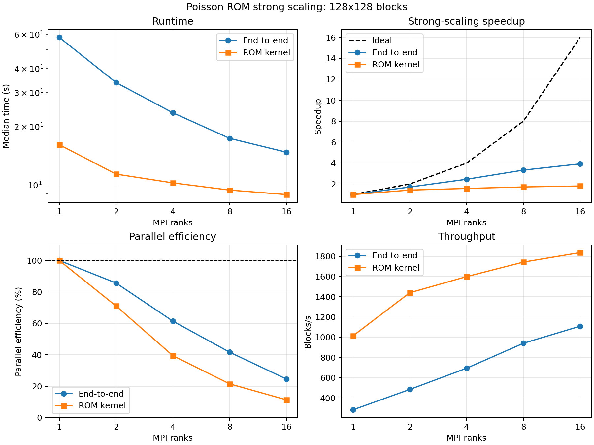
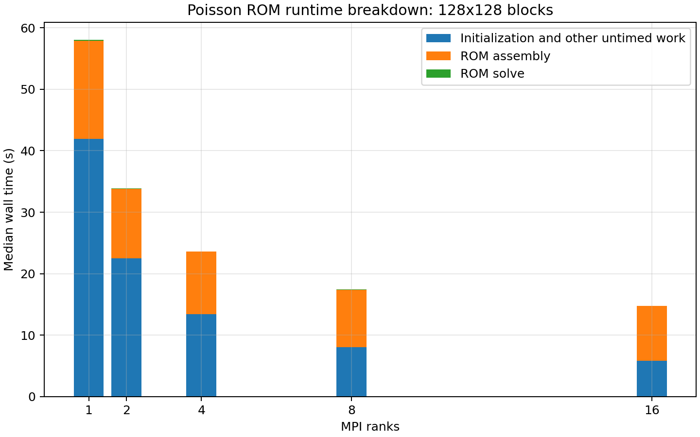
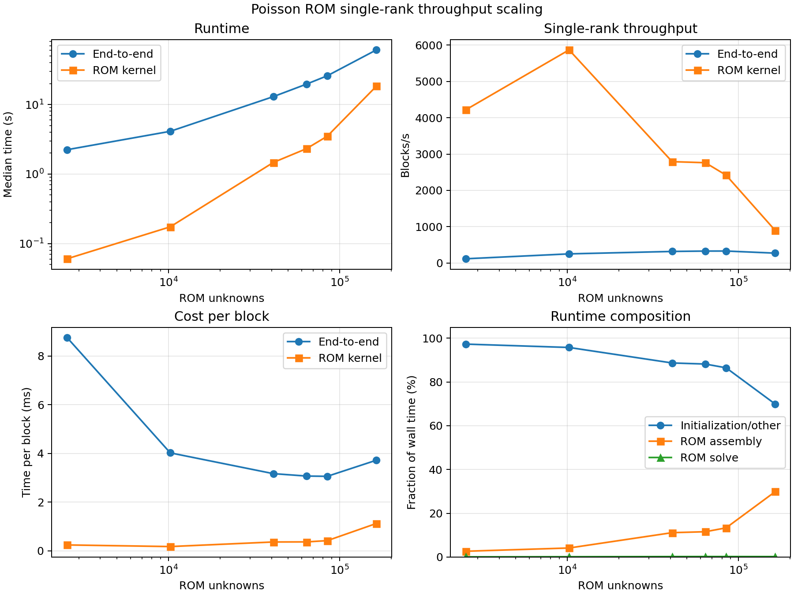
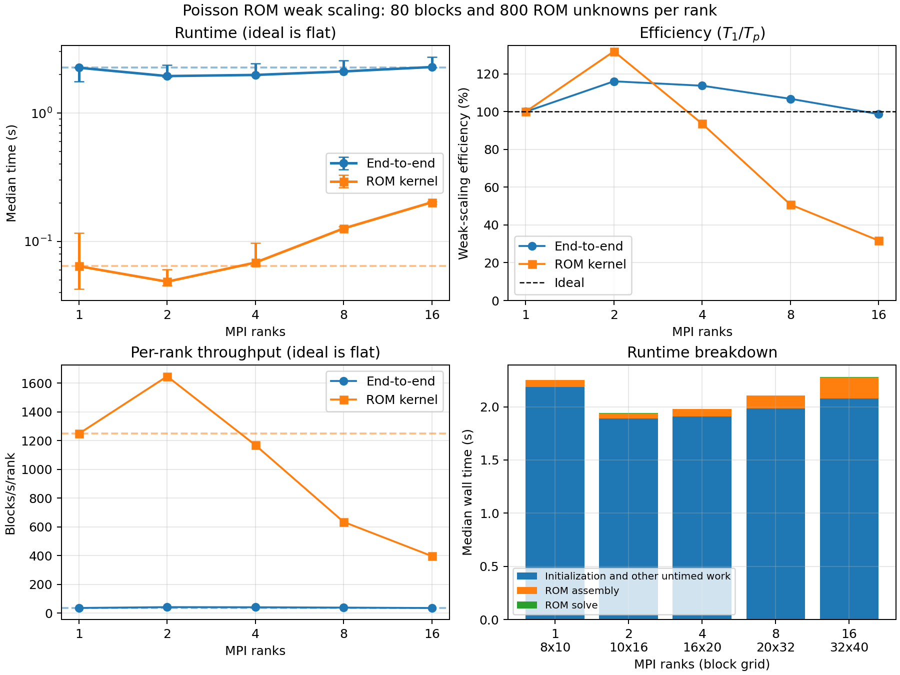

# Poisson ROM Scaling Results

## Strong-scaling experiment

The component Poisson ROM was run on a fixed 128-by-128 configuration:

- 16,384 component blocks;
- 10 reduced basis coefficients per block;
- 163,840 total ROM unknowns;
- 1, 2, 4, 8, and 16 MPI ranks; and
- three repetitions per rank count.

The table reports medians. End-to-end time is the complete `srun` duration.
Kernel time is the application's reported ROM assembly plus solve time.

| MPI ranks | Wall time (s) | Wall speedup | Wall efficiency | Kernel time (s) | Kernel speedup | Wall throughput (blocks/s) |
|---:|---:|---:|---:|---:|---:|---:|
| 1  | 58.06 | 1.00 | 100% | 16.17 | 1.00 | 282 |
| 2  | 33.90 | 1.71 | 86%  | 11.38 | 1.42 | 483 |
| 4  | 23.64 | 2.46 | 61%  | 10.25 | 1.58 | 693 |
| 8  | 17.43 | 3.33 | 42%  | 9.40  | 1.72 | 940 |
| 16 | 14.78 | 3.93 | 25%  | 8.92  | 1.81 | 1,109 |





## Conclusions

- The implementation provides useful end-to-end scaling through 16 ranks, but
  it is substantially sublinear. Sixteen ranks give a 3.93-times wall-clock
  speedup and approximately 25% parallel efficiency.
- Initialization and other work outside the reported ROM kernel remain the
  largest contribution. At the median, this work falls from about 41.9 seconds
  on one rank to 5.9 seconds on 16 ranks.
- ROM kernel scaling plateaus early. Its median time decreases from 16.17 to
  8.92 seconds, only a 1.81-times speedup on 16 ranks.
- The reduced linear solve scales from approximately 0.123 seconds to 0.020
  seconds and is negligible in the overall runtime. ROM assembly, rather than
  the solve, dominates the timed kernel.
- The assembly path retains globally structured work. In particular, current
  code comments identify global block construction and scans over all ROM
  blocks as work that should be made local. This is a likely contributor to the
  observed kernel plateau.
- Increasing from 8 to 16 ranks reduces median wall time by only about 15%.
  For this problem and implementation, 8 ranks offer a better efficiency/time
  compromise, while 16 ranks provide the best observed time to solution.

## Reproducing the plots

From `build/examples/poisson_parallel`, run:

```bash
MPLCONFIGDIR=/tmp/matplotlib-cache ./plot_benchmarks.py
```

The plotting script reads `benchmarks/results.csv` and uses the latest three
records for every rank count, avoiding earlier partial benchmark campaigns in
the same CSV file.

## Single-rank throughput scaling

A single-rank sweep used square grids from 16-by-16 through 92-by-92 blocks.
The following table reports medians of three runs.

| Grid | Blocks | ROM unknowns | Wall time (s) | Kernel time (s) | Wall throughput (blocks/s) |
|---:|---:|---:|---:|---:|---:|
| 16x16 | 256   | 2,560  | 2.24  | 0.061 | 114 |
| 32x32 | 1,024 | 10,240 | 4.11  | 0.174 | 249 |
| 64x64 | 4,096 | 40,960 | 12.96 | 1.468 | 316 |
| 80x80 | 6,400 | 64,000 | 19.62 | 2.318 | 326 |
| 92x92 | 8,464 | 84,640 | 25.86 | 3.501 | 327 |
| 128x128 | 16,384 | 163,840 | 60.89 | 18.335 | 269 |




End-to-end throughput rises rapidly through approximately 40,000 ROM unknowns,
then plateaus near 325--330 blocks per second between 64,000 and 85,000 ROM
unknowns. This agrees with the expected single-rank saturation range of roughly
50,000--100,000 unknowns. At 163,840 unknowns, throughput has fallen to about
269 blocks per second, confirming that the saturation point has been passed.
The solve remains negligible; topology/mesh setup and ROM assembly account for
almost all wall time. Kernel-only block throughput peaks at a smaller problem
size and then declines, indicating increasing assembly cost per block even
while fixed startup costs are being amortized.

## Weak scaling

The weak-scaling sweep held the workload at 80 component blocks (800 ROM
unknowns) per MPI rank and increased the global problem from 80 blocks on one
rank to 1,280 blocks on 16 ranks. The table reports medians of three runs.
Weak-scaling efficiency is the one-rank median divided by the median at each
rank count; 100% is ideal.

| MPI ranks | Grid | Blocks | Wall time (s) | Wall efficiency | Kernel time (s) | Kernel efficiency |
|---:|---:|---:|---:|---:|---:|---:|
| 1  | 8x10  | 80    | 2.252 | 100% | 0.064 | 100% |
| 2  | 10x16 | 160   | 1.940 | 116% | 0.049 | 132% |
| 4  | 16x20 | 320   | 1.979 | 114% | 0.068 | 94%  |
| 8  | 20x32 | 640   | 2.108 | 107% | 0.126 | 51%  |
| 16 | 32x40 | 1,280 | 2.281 | 99%  | 0.202 | 32%  |



End-to-end weak scaling is nearly ideal through 16 ranks: the median wall time
at 16 ranks is only 1.3% above the one-rank median. The greater-than-100%
efficiencies at 2--8 ranks reflect faster medians than the one-rank baseline,
which is affected by startup costs and run-to-run variability. In contrast,
the ROM kernel grows from 0.064 seconds on one rank to 0.202 seconds on 16
ranks, reducing kernel weak efficiency to about 32%. The kernel is a small
fraction of these short runs, so its loss of scaling is currently masked by
roughly two seconds of initialization and other untimed work. A larger
per-rank workload would give a more stable measurement of kernel weak scaling.
